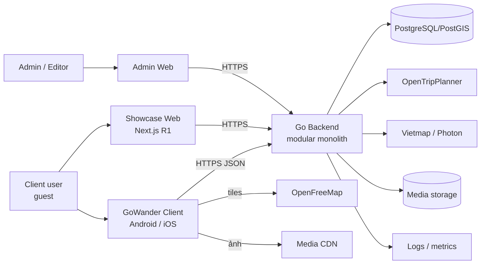

# 01 — System Context

- **Trạng thái:** Draft
- **Ngày:** 18-11-2026
- **Chủ sở hữu:** chủ dự án
- **Liên quan:** `02-containers.md`, `../00-foundation/02-scope.md`, `../03-decisions/`

## TL;DR

GoWander là một hệ sinh thái gồm **2 app mobile**, **3 khu vực web** và **1 backend dùng chung**. Backend là nơi duy nhất nói chuyện với database, OTP và các nhà cung cấp ngoài; client/Admin không gọi thẳng các dịch vụ đó.

R1 gồm **Client Mobile + Admin Web + Showcase Web** (marketing). Client Web app, Partner Web, Business Mobile và các domain Community/AI/Ads/Affiliate/Booking có mặt trong định hướng nhưng **không nằm trong context R1**.

## Actors

| Actor | Mô tả | R1 |
|---|---|---|
| **Client user** | Du khách/người dùng cuối; guest-first; tài khoản từ R1.5 | ✅ |
| **Admin** | Vận hành nội dung, địa điểm, ảnh, feedback, người dùng | ✅ |
| **Editor** | Biên tập nội dung/guide; có thể là role riêng của Admin | ✅ (role) |
| **Partner** | Đối tác dịch vụ/khuyến mãi/booking | ❌ R6 |
| **Support** | Xử lý feedback/incident; dùng Admin | ⏳ |
| **Developer/Operator** | CI/CD, monitoring, backup | ⏳ R1 mức tối thiểu |

## Systems

### Trong phạm vi GoWander

| System | Vai trò | R1 | Ghi chú |
|---|---|---|---|
| **GoWander Client** | Android/iOS cho người dùng cuối | ✅ | Client Web sau |
| **GoWander Business** | App Partner/Admin dùng phân quyền | ❌ | R6/R8 |
| **Client Web** | Web cho người dùng cuối | ✅ marketing R1; app sau | Next.js + TypeScript; Showcase (dịch vụ/giá/chính sách) trong R1, app sau |
| **Partner Web** | Web cho đối tác | ❌ | React + TypeScript + Vite; R6 |
| **Admin Web** | Vận hành nội dung/địa điểm/feedback | ✅ | React + TypeScript + Vite (ADR-0001) |
| **Go Backend** | API + business logic + Admin | ✅ | Modular monolith |
| **PostgreSQL/PostGIS** | Dữ liệu địa điểm, guide, feedback, account, admin | ✅ | Không lưu plan cá nhân mặc định |
| **Media storage** | Ảnh do Admin upload/ảnh địa điểm | ✅ | R2/S3-compatible hoặc local cho dev |
| **Monitoring/logging** | Log, metric, alert | ⏳ | R1 tối thiểu; R6 đầy đủ |

### Bên ngoài (third-party)

| System | Dùng cho | R1 | Nếu lỗi |
|---|---|---|---|
| **OpenTripPlanner (OTP)** | Tìm tuyến transit + walk/bike | ✅ | Trả lỗi rõ; không bịa tuyến |
| **OpenStreetMap / OpenFreeMap** | Bản đồ nền, dữ liệu đường | ✅ | Bản đồ có thể thiếu tile; vẫn dùng cache/fallback |
| **Ảnh vệ tinh** | Cần nhà cung cấp có giấy phép (Esri World Imagery cần giấy phép ArcGIS) | ❌ ngoài R1 | Chọn nhà cung cấp trả phí sau R1; app không hiện lớp vệ tinh |
| **Photon** | Geocoding fallback | ✅ | Dùng Vietmap nếu có; nếu cả hai lỗi → báo lỗi |
| **Vietmap** | Geocoding/bản đồ trả phí (khi có key) | ⏳ | Fallback Photon |
| **Open-Meteo** | Thời tiết cho plan/route | ⏳ R2 | Ẩn weather, không chặn plan |
| **Mapillary** | Ảnh đường phố | ⏳ | Ẩn ảnh, dùng bản đồ |
| **Cloudflare R2 / S3** | Lưu ảnh | ⏳ | Dùng local cho dev; báo lỗi upload |
| **Google Sign-In** | Đăng nhập client (R1.5) | ❌ R1 | Guest-first; không chặn |
| **Email/SMS** | Xác thực/khôi phục Admin/account | ⏳ | Admin reset qua email; client sau |
| **Payment/Booking partners** | Booking/affiliate | ❌ R7 | Không có trong R1 |
| **AI provider** | AI Companion | ❌ R5 | Không có trong R1 |

## Context diagram (R1)



- **Ngoài sơ đồ R1:** Weather (R2) và Mapillary (tùy chọn) không vẽ để giữ sơ đồ rõ; khi bật vẫn đi qua API.
- **Client không gọi OTP/DB/Vietmap/Open-Meteo trực tiếp.** Mọi thứ đi qua API, trừ tile bản đồ/ảnh CDN (theo URL API trả về) để giảm tải backend.
- **Admin Web** là SPA React/Vite riêng, phục vụ cùng origin qua reverse proxy; gọi API, không nhúng trong Go.
- **Showcase Web** là phần marketing của Client Web (Next.js), R1 chỉ các trang công khai; app Client Web sau.
- **Plan cá nhân** lưu trên máy; API chỉ cần cho route/place/guide/weather.

## Luồng chính

### 1. Tìm tuyến

```text
Client → API /routes/plan → OTP → API chuẩn hoá response → Client
```

- API chịu trách nhiệm: validate input, gọi OTP, timeout, map response, gắn `dataStatus`.
- Client không thấy OTP; chỉ thấy route/legs/steps.

### 2. Discover / Guide

```text
Client → API /places, /places/{id}, /guide → PostgreSQL/PostGIS → API → Client
```

- Place/guide có `source`, `license`, `attribution`; client phải hiển thị.
- Ảnh đi qua media/Mapillary, có credit.

### 3. Plan cá nhân

```text
Client → (local) tạo/sửa plan → API /routes/plan cho từng leg → local lưu plan
```

- Không cần tài khoản ở R1.
- Nếu API lỗi, plan vẫn giữ; leg hiển thị “chưa tính được”.

### 4. Weather (R2)

```text
Client → API /weather → Open-Meteo → cache → Client
```

- Weather là gợi ý, không chặn plan.
- Dữ liệu thời tiết phải ghi nguồn/giờ.

### 5. Admin

```text
Admin Web → API /admin/* → PostgreSQL / media storage
```

- RBAC: `admin`/`editor`.
- Audit log cho thay đổi nội dung (tối thiểu).

### 6. Community/AI/Ads/Booking (sau)

- Không có trong R1.
- Khi thêm, vẫn đi qua API; không tạo service riêng trước khi có ADR.

## Trust boundaries

| Boundary | Điều gì đi qua | Kiểm soát |
|---|---|---|
| Client ↔ API | JSON, bearer token (client account từ R1.5; guest không token), ảnh upload (R1.6) | HTTPS, auth, rate limit, validate input |
| API ↔ DB | SQL, migration | Role DB riêng, không expose DB, backup |
| API ↔ OTP | HTTP nội bộ | Timeout, không lộ OTP ra client |
| API ↔ third-party | Geocode/weather/ảnh | Key ở server, timeout, fallback, không log secret |
| Admin ↔ API | Session cookie httpOnly (không token trong localStorage), upload | RBAC, CSRF, audit, giới hạn file |
| Client ↔ tile/CDN | Tile/ảnh | HTTPS, credit/license |

## Data ownership (source of truth)

| Dữ liệu | Nơi lưu | Ghi chú |
|---|---|---|
| Place/category/guide | PostgreSQL/PostGIS | Admin quản lý |
| Feedback | PostgreSQL | Có thể chứa PII; retention rõ |
| Account/Admin | PostgreSQL | Client account sau; Admin R1 |
| Plan/saved places | Thiết bị | Guest-first; không mặc định lên server |
| Route/legs | Không lưu lâu | Sinh từ OTP; cache ngắn nếu cần |
| Weather | Cache ngắn | Không lưu lịch sử |
| Ảnh | Media storage/Mapillary | Credit/license |
| Analytics | DB/log | Tối thiểu; không PII |

## Ràng buộc

- **Dữ liệu transit giả định:** chưa có GTFS chính thức/GTFS-RT; mọi route phải có nhãn.
- **OTP không có profile motorbike:** R1 không làm xe máy.
- **Bản đồ chủ quyền:** tile/OSM không mặc nhiên đáp ứng yêu cầu pháp lý; cần rà trước release.
- **License ảnh:** Mapillary CC BY-SA; ảnh Admin có credit.
- **Open-Meteo free phi thương mại:** mua/self-host trước thương mại.
- **Thiết bị thật/HTTPS:** dev có thể dùng emulator/simulator; gate R1 (20–30 người thử) cần thiết bị thật và HTTPS.
- **Tile bản đồ:** OpenFreeMap không có SLA; quyết định tự host/nhà cung cấp có hợp đồng trước pilot (xem gate R1).
- **Không có microservice/K8s** ở R1; một backend + Postgres + OTP.

## Ngoài phạm vi file này

- Chi tiết container/module: `02-containers.md`.
- Data model chi tiết: `03-data-model.md`.
- API contract: `04-api-contract.md`.
- Security/privacy: `05-security-privacy.md`.
- Deployment/runbook: `../05-operations/`.

## Câu hỏi mở

- Admin static phục vụ bởi Go hay reverse proxy/CDN?
- Media storage: local dev + R2 production, hay self-host?
- Có cần cache route/place ở edge/CDN không?
- Monitoring R1 tối thiểu gồm những gì?
