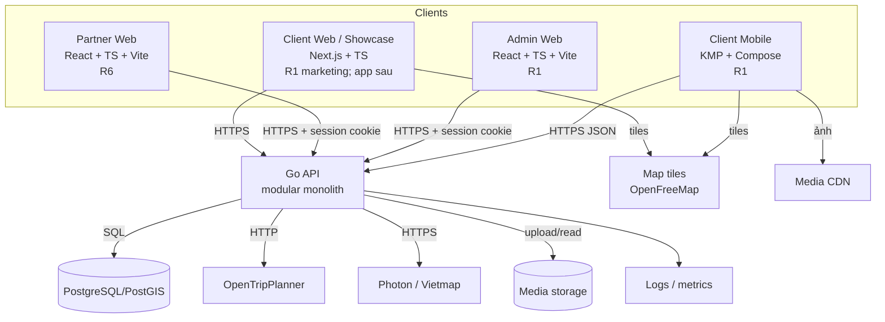

# 02 — Containers

- **Trạng thái:** Draft
- **Ngày:** 18-11-2026
- **Chủ sở hữu:** chủ dự án
- **Liên quan:** `01-system-context.md`, `../03-decisions/ADR-0001-web-stack.md`

## TL;DR

GoWander chạy trên **6 container chính** ở R1:

1. **Client Mobile** — Android/iOS (KMP + Compose).
2. **Client Web / Showcase** — Next.js + TypeScript; R1 chỉ marketing (Home, Download, Contact, Privacy, Terms, Map/Data), build tĩnh; app sau.
3. **Admin Web** — React + TypeScript + Vite (SPA).
4. **Go API** — modular monolith, nơi duy nhất chứa business logic.
5. **PostgreSQL/PostGIS** — dữ liệu nội dung/địa điểm/feedback/account.
6. **OpenTripPlanner (OTP)** — engine tìm tuyến.

Ngoài ra có **Photon/Vietmap** (geocoding), **media storage**, **map tile providers** và **monitoring**. Partner Web (React/Vite) và Client Web app mở sau; Showcase marketing có trong R1.

## Sơ đồ container



Ghi chú:

- **Client Mobile/Client Web** gọi tile/ảnh CDN trực tiếp theo URL API trả về; không gọi OTP/DB.
- **Admin/Partner Web** là SPA tĩnh, phục vụ cùng origin với `/api` (reverse proxy) để cookie/CSRF đơn giản.
- **Client Web** dùng Next.js; R1 chỉ marketing (SSG/SEO), app sau; gọi cùng API.
- Weather (R2), Mapillary (optional), AI/Community/Booking không vẽ để giữ sơ đồ R1 rõ.

## Container responsibilities

| Container | Tech | R1 | Trách nhiệm | Không làm |
|---|---|---|---|---|
| **Client Mobile** | KMP + Compose; MapLibre; Ktor client | ✅ | UI, map, route, discover, plan local, settings, language | Không nói chuyện DB/OTP; không chứa business logic server |
| **Admin Web** | React + TS + Vite | ✅ | CRUD places/guide/feedback/media; editor; dashboard; RBAC; **moderation queue R1.5** | Không gọi DB/OTP trực tiếp |
| **Partner Web** | React + TS + Vite | ❌ R6 | Dashboard đối tác, khuyến mãi, ads/affiliate/booking | Không tự tính route/giá |
| **Client Web** | Next.js + TS | ✅ marketing R1 (6 trang, tĩnh); app sau | Landing, SEO, download, contact (email), Privacy/Terms/Map-Data; app sau | Không nhân bản API logic; không form thu PII ở R1 |
| **Go API** | Go (chi/pgx) | ✅ | Auth, validate, route, discover, admin, media, weather proxy | Không render UI mobile; không lưu plan mặc định |
| **PostgreSQL/PostGIS** | Postgres + PostGIS | ✅ | Place/category/guide/feedback/account/admin; geo queries | Không lưu plan cá nhân mặc định |
| **OTP** | OpenTripPlanner | ✅ | Graph TP.HCM (bus + Metro L1 + OSM); tìm tuyến; vùng khác sau | Không lộ ra client; không gộp graph toàn quốc |
| **Photon/Vietmap** | Photon self-host / Vietmap API | ✅ | Geocoding/reverse | Không lưu query/PII |
| **Media storage** | R2/S3 hoặc local dev | ✅ | Ảnh Admin; **ảnh đề xuất R1.6** (1–3, pending, strip EXIF, sau cổng pháp lý); credit/license | Không chứa secret |
| **Monitoring** | Log/metric/alert | ⏳ | Health, lỗi, latency, cảnh báo | Không log PII/token |
| **Map tiles** | OpenFreeMap (không SLA; quyết định tự host/nhà cung cấp trước pilot) | ✅ | Tile bản đồ 2D/3D | Không dùng tile không rõ license; không vệ tinh ở R1 |

## Module logic trong Go API

Đây **không phải container riêng**; là module trong monolith:

| Module | R1 | Trách nhiệm |
|---|---|---|
| **Identity** | ✅ Admin; R1.5 client | Đăng nhập Admin, session, RBAC; client account + email/Google ở R1.5 |
| **Mobility** | ✅ | Route request/response, OTP adapter, `dataStatus`; coverage TP.HCM R1 |
| **Discover** | ✅ | Place/category/guide, PostGIS queries; place submissions + moderation ở R1.5 |
| **Journey** | ⏳ R2 | Wander Mode, plan server-side (nếu cần), recommendations |
| **Media** | ✅ | Upload/read ảnh, credit/license |
| **Admin/Backoffice** | ✅ | API cho Admin Web, audit, feedback |
| **Weather** | ⏳ R2 | Open-Meteo proxy/cache |
| **AI** | ❌ R5 | AI Companion, bounded sources |
| **Community** | ❌ R4 | Post/follow/comment/moderation |
| **Ads** | ❌ R6 | Ad slot, sponsored label |
| **Affiliate** | ❌ R6 | Referral/commission |
| **Booking** | ❌ R7 | External/partner booking |

## Giao tiếp

| Từ → Đến | Giao thức | Ghi chú |
|---|---|---|
| Client Mobile → API | HTTPS JSON | Bearer token nếu có account; guest không token |
| Admin/Partner Web → API | HTTPS JSON + cookie | Session httpOnly, CSRF |
| Client Web → API | HTTPS JSON | R1 marketing/public; app và account sau |
| API → OTP | HTTP nội bộ | Timeout, retry có kiểm soát; không lộ OTP |
| API → DB | PostgreSQL protocol | Pool, role riêng, migration |
| API → Photon/Vietmap | HTTPS | Key server; fallback |
| API → Open-Meteo | HTTPS | Cache; attribution |
| API → Media | S3 API/local | Upload validate; CDN URL |
| Client → Tiles/CDN | HTTPS | URL do API/config trả về; credit |

## Dữ liệu theo container

| Dữ liệu | Container | Ghi chú |
|---|---|---|
| Place/category/guide | DB | PostGIS; source/license |
| Feedback | DB | Có thể chứa PII; retention |
| Place submissions | DB | R1.5; account_id, status, moderation; không public khi pending |
| Place submission photos | DB + media | R1.6; 1–3 ảnh, pending, EXIF stripped, credit; chỉ public khi duyệt |
| Moderation audit | DB | R1.5; ai duyệt, khi nào, lý do |
| Account/Admin | DB | Password hash; session/token |
| Plan/saved places | Client Mobile | Local-first; saved places local ở R1; sync R3 |
| Route/legs | API/OTP | Không lưu lâu; cache ngắn nếu cần |
| Weather | API cache | Không lưu lịch sử |
| Ảnh | Media storage | Credit/license |
| Logs/metrics | Monitoring | Không PII/token |

## Triển khai R1

```text
Một máy/host hoặc docker compose:
  - reverse proxy (HTTPS)
  - Go API
  - PostgreSQL/PostGIS
  - OTP (graph TP.HCM)
  - Photon (hoặc Vietmap qua API)
  - static Admin Web
  - media (local/R2)
  - monitoring tối thiểu
```

- **Showcase R1 là build tĩnh (static export) host riêng** (CDN/static hosting), không chạy Node chung host với OTP/DB; để trang marketing không phụ thuộc host pilot.
- **Không K8s/microservice.**
- API stateless; scale ngang sau.
- OTP cần RAM/CPU; chạy cùng host có thể đủ pilot.
- Admin static build có thể phục vụ bởi reverse proxy hoặc Go.
- Client Mobile build APK/TestFlight; store release sau gate.

## Bảo mật theo container

| Container | Kiểm soát |
|---|---|
| Client Mobile | Không lưu secret; token Keychain/Keystore; certificate pinning sau |
| Admin/Partner Web | Cookie httpOnly/SameSite, CSRF, CSP, RBAC, không token localStorage |
| Client Web / Showcase | Public; CSP, form anti-spam; không thu PII trước consent |
| Go API | Validate input, rate limit, auth, error envelope, không log PII |
| DB | Role riêng, không expose port public, backup |
| OTP | Chỉ nội bộ; timeout; không nhận input chưa validate |
| Media | Giới hạn loại/kích thước file; scan nếu cần; credit |
| Monitoring | Mask PII, retention |

## Câu hỏi mở

- Admin static phục vụ bởi Go hay reverse proxy/CDN?
- Media R1: local hay R2 ngay?
- Photon self-host hay Vietmap primary ngay R1?
- OTP chạy cùng host hay container riêng?
- Mở graph Hà Nội/Đà Nẵng khi nào? (sau R1, theo coverage)
- Monitoring R1 tối thiểu: log + health hay thêm Prometheus?
- Client Mobile có cần offline cache tile/route ở R1 không?
- Showcase dùng MDX/JSON hay CMS ở R1? Domain nào?

## Việc tiếp theo

- [ ] Duyệt file này.
- [ ] Viết `03-data-model.md`.
- [ ] Viết `04-api-contract.md`.
- [ ] Viết `05-security-privacy.md`.
- [ ] Viết ADR-0003 (API/auth) và ADR-0004 (data/PostGIS); chốt ADR-0002 (tài khoản/vai trò).
