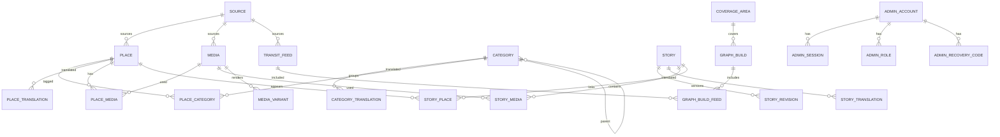

# 03 — Data model (R1)

- **Trạng thái:** Proposed — chờ chủ dự án chốt
- **Ngày:** 18-11-2026
- **Chủ sở hữu:** chủ dự án
- **Liên quan:** `01-system-context.md`, `02-containers.md`, `../03-decisions/ADR-0003-api-contract-auth-rbac.md`, `../03-decisions/ADR-0004-data-model-postgis.md`, `../03-decisions/ADR-0005-routing-algorithm.md`, `../04-development/02-conventions.md`, `../07-changes/change-18-11-2026.md`

## TL;DR

- Tài liệu này **chi tiết hoá ADR-0004 cho R1**, không quyết định lại: PostgreSQL + PostGIS, SRID 4326, UUIDv7 sinh ở ứng dụng, schema theo module, tiền `bigint` VND, `timestamptz` UTC.
- R1 chỉ có **6 schema với 27 bảng**: `catalog` (12), `media` (2), `mobility` (4), `identity` (4), `engagement` (1), `backoffice` (4). Không có bảng khách hàng, quán, đặt trước hay thanh toán — các phase đó mở sau.
- Bảng **không** có trong R1: `identity.account`, `identity.auth_identity`, `identity.account_session`, `identity.verification_code`, `identity.password_history`, toàn bộ `partner`, `booking`, `catalog.place_submission*`, `engagement.notification*`. Khi mở R1.5/R6 sẽ thêm migration riêng, không tạo bảng rỗng trước.
- Khác biệt nhỏ so với danh sách bảng ở ADR-0004 mục 2: tài liệu này thêm `catalog.place_media` (ADR-0004 mục 4.1 đã mô tả bảng này nhưng mục 2 liệt kê thiếu) và `backoffice.outbox_event.dedupe_key` (ADR-0004 nhắc `dedupe_key` khi xử lý nhưng không liệt kê cột). Ghi ở mục 9.
- Mọi con số giới hạn/retention dưới đây lấy từ ADR-0004 hoặc ghi rõ `ASSUMED`; chưa có dữ liệu tải thật.

## 1. Phạm vi R1

| Nhóm | R1 | Ghi chú |
|---|---|---|
| Nội dung địa lý: source, category, place, story, media | ✅ | Client Mobile + Admin Web R1 |
| Routing metadata: coverage, feed, graph build | ✅ | OTP TP.HCM; label `ASSUMED` |
| Admin identity + phiên + 2FA | ✅ | Admin Web R1 |
| Feedback guest | ✅ | `POST /api/v1/feedback` |
| Audit + outbox + import | ✅ | Audit Admin; outbox email; import OSM/GTFS |
| Client account, submission, ảnh người dùng | ❌ R1.5/R1.6 | Không tạo bảng trước |
| Quán/Partner, booking, payment | ❌ R6/R7 | Không tạo bảng trước |
| Notification 4 hộp thư | ❌ | R1 chỉ email qua outbox; bảng `notification` thêm khi có UI hộp thư |
| Plan/saved places | ❌ (local) | Thiết bị giữ; không có bảng server R1 |

## 2. Schema và quyền sở hữu

| Schema | Module sở hữu | Bảng R1 | Ghi chú |
|---|---|---|---|
| `catalog` | Discover | `source`, `category`, `category_translation`, `place`, `place_translation`, `place_category`, `place_media`, `story`, `story_revision`, `story_translation`, `story_media`, `story_place` | 12 bảng |
| `media` | Media | `media`, `media_variant` | 2 |
| `mobility` | Mobility | `coverage_area`, `transit_feed`, `graph_build`, `graph_build_feed` | 4 |
| `identity` | Identity | `admin_account`, `admin_session`, `admin_role`, `admin_recovery_code` | 4 |
| `engagement` | Feedback | `feedback` | 1 |
| `backoffice` | Admin/Backoffice | `audit_log`, `outbox_event`, `import_run`, `import_issue` | 4 |

Quy tắc:

- Mỗi bảng **một module ghi**; module khác đọc qua view `backoffice.v_*` hoặc API nội bộ, không `UPDATE` chéo schema.
- FK giữa schema được phép (ví dụ `catalog.place.primary_category_id → catalog.category.id`); quyền ghi vẫn thuộc module sở hữu.
- Không đặt bảng ứng dụng trong `public`; extension (`postgis`, `pg_trgm`, `citext`) ở `public`.
- `search_path` tường minh, không để `public` đứng trước.

## 3. ERD R1



## 4. Quy ước chung

| Chủ đề | Quy ước |
|---|---|
| Khoá chính | `id uuid`, ứng dụng sinh **UUIDv7**; không `serial`/`bigserial` |
| Thời gian | `timestamptz`, mặc định `now()`; API trả ISO 8601 UTC |
| Xoá mềm | `deleted_at timestamptz` cho nội dung; truy vấn công khai lọc `deleted_at is null`; unique index có điều kiện |
| Trạng thái | `text` + `CHECK` (không dùng enum PostgreSQL) để thêm giá trị bằng migration thường, dễ đọc trong `sqlc` |
| Tiền | `bigint` VND, `check (amount >= 0)`, `currency char(3) not null default 'VND'`; không `numeric`/`float` |
| Chuỗi | `text` + `check (char_length(...) <= N)`; giới hạn là **đề xuất**, ghi rõ trong cột |
| JSON | `jsonb` chỉ cho story block, audit before/after, payload outbox; field query chính vẫn là cột riêng |
| Toạ độ | `geography(Point,4326)` cho điểm; `geometry(MultiPolygon/LineString,4326)` cho vùng/đường; không lưu lat/lon dạng `text` |
| PII | Không lưu token/mật khẩu/giấy tờ dạng đọc được; `ip_hash` là HMAC-SHA-256, không lưu IP thô |
| Audit | Bảng append-only; role app không có `UPDATE`/`DELETE` |

## 5. Chi tiết bảng

### 5.1 `catalog`

#### `catalog.source`

| Cột | Kiểu | Null | Ghi chú |
|---|---|---|---|
| `id` | uuid | no | PK |
| `code` | text | no | unique; `osm`, `manual`, `vietmap`, `gtfs_assumed`, `demo` |
| `name` | text | no | |
| `url` | text | yes | |
| `license_code` | text | no | `ODbL-1.0`, `CC-BY-4.0`, `CC-BY-SA-4.0`, `CC0`, `proprietary`, `internal` |
| `license_url` | text | yes | |
| `attribution` | text | no | Chuỗi bắt buộc hiển thị, ví dụ “© OpenStreetMap contributors” |
| `terms_reviewed_at` | timestamptz | yes | |
| `terms_reviewed_by` | text | yes | Ai rà điều khoản |
| `notes` | text | yes | Giới hạn cache/dùng |
| `created_at`, `updated_at` | timestamptz | no | |

#### `catalog.category` / `category_translation`

| Cột | Kiểu | Null | Ghi chú |
|---|---|---|---|
| `id` | uuid | no | PK |
| `code` | text | no | unique; `food`, `cafe`, `hospital`, `metro_station`, `atm`… |
| `icon` | text | yes | Tên icon trong bộ token, không nhúng SVG |
| `parent_id` | uuid | yes | FK self, `ON DELETE RESTRICT` |
| `sort_order` | int | no | default 0 |
| `status` | text | no | `active`, `hidden` (check) |
| `created_at`, `updated_at` | timestamptz | no | |

`category_translation`: PK `(category_id, locale)`; `locale` (`vi`,`en`), `name`, `description` nullable. Thiếu bản dịch ⇒ API fallback `vi` và trả `locale` thực tế.

#### `catalog.place`

| Cột | Kiểu | Null | Ghi chú |
|---|---|---|---|
| `id` | uuid | no | PK |
| `slug` | text | no | unique có điều kiện `where deleted_at is null`; dùng URL/SEO sau |
| `name` | text | no | Tên mặc định VI; `check (char_length(name) between 1 and 200)` |
| `location` | geography(Point,4326) | yes | Bắt buộc khi `status='published'` |
| `entrance` | geography(Point,4326) | yes | Chỉ dẫn điểm vào |
| `address`, `ward`, `district`, `city`, `country` | text | yes | Hành chính; không thay geocoding |
| `bbox` | geometry(Polygon,4326) | yes | Vùng thô để tìm/hiển thị |
| `primary_category_id` | uuid | yes | FK `category`; bắt buộc khi publish |
| `verification` | text | no | `unverified`, `verified`, `official`; default `unverified` |
| `status` | text | no | `draft`, `published`, `hidden`, `merged`; default `draft` |
| `merged_into_id` | uuid | yes | FK self khi gộp trùng |
| `data_status` | text | no | `DEMO`, `OFFICIAL`, `ASSUMED`, `BEST_EFFORT`; default `DEMO` |
| `source_id` | uuid | yes | FK `source`; bắt buộc khi publish |
| `source_ref` | text | yes | `osm:node/123`, `manual:...` |
| `source_url` | text | yes | |
| `retrieved_at` | timestamptz | yes | |
| `opening_hours` | text | yes | Cú pháp OSM; parse ở app, không coi là giờ chính thức |
| `phone`, `website` | text | yes | |
| `price_level` | smallint | yes | Ước tính 1–4; `ASSUMED` nếu không có nguồn |
| `indoor`, `wheelchair` | boolean | yes | `wheelchair` theo OSM (`yes/no/limited` map sang boolean + null) |
| `summary` | text | yes | Ngắn ≤ 500 ký tự (đề xuất) |
| `description` | text | yes | Dài ≤ 5.000 ký tự (đề xuất), plain text |
| `search_text` | text | yes | lowercase, bỏ dấu, gộp khoảng trắng; app ghi khi tạo/sửa |
| `featured_rank` | int | yes | Thứ tự biên tập cho danh sách “nổi bật”; nhỏ trước, null xuống cuối (đề xuất 19-11-2026) |
| `created_by`, `updated_by` | uuid | yes | FK `identity.admin_account` |
| `created_at`, `updated_at` | timestamptz | no | |
| `deleted_at` | timestamptz | yes | |

- `name`, `summary`, `description` trên `place` là bản **VI mặc định**; `place_translation` giữ bản EN (và bản VI nếu sau này cần tách). Thiếu bản dịch ⇒ API fallback VI.
- `category` không có cột `name`: tên nằm ở `category_translation`; bắt buộc có dòng `locale='vi'` khi tạo.

Ràng buộc:

```sql
CHECK (status IN ('draft','published','hidden','merged'))
CHECK (verification IN ('unverified','verified','official'))
CHECK (data_status IN ('DEMO','OFFICIAL','ASSUMED','BEST_EFFORT'))
CHECK (status <> 'published' OR (location IS NOT NULL AND source_id IS NOT NULL AND primary_category_id IS NOT NULL))
CHECK (verification <> 'official' OR source_id IS NOT NULL)  -- official phải truy được nguồn
```

#### `catalog.place_translation`

PK `(place_id, locale)`; `name`, `summary`, `description` nullable. Không tự dịch máy ở R1; thiếu bản dịch thì fallback VI.

#### `catalog.place_category`

PK `(place_id, category_id)`; `sort_order int not null default 0`. `place.primary_category_id` là danh mục hiển thị chính; bảng nối cho lọc nhiều danh mục.

#### `catalog.place_media`

| Cột | Kiểu | Ghi chú |
|---|---|---|
| `place_id` | uuid | FK `place`, `ON DELETE CASCADE` |
| `media_id` | uuid | FK `media.media`, `ON DELETE RESTRICT` |
| `role` | text | `cover`, `gallery` |
| `sort_order` | int | default 0 |

PK `(place_id, media_id)`; partial unique `(place_id) where role='cover'` để mỗi place một ảnh bìa.

> ADR-0004 mục 4.1 mô tả `place_media` nhưng mục 2 không liệt kê; xem mục 9.

#### `catalog.story` / `story_revision` / `story_translation`

`story`:

| Cột | Kiểu | Ghi chú |
|---|---|---|
| `id` | uuid | PK |
| `slug` | text | unique có điều kiện `where deleted_at is null` |
| `kind` | text | `historical`, `guide`, `food` |
| `status` | text | `draft`, `in_review`, `scheduled`, `published`, `hidden` |
| `data_status` | text | `DEMO`, `OFFICIAL`, `ASSUMED`, `BEST_EFFORT`; default `DEMO` |
| `current_revision_id` | uuid | FK `story_revision`; phải thuộc cùng `story_id` (service kiểm trong transaction) |
| `published_at` | timestamptz | |
| `created_by`, `updated_by` | uuid | FK `identity.admin_account` |
| `created_at`, `updated_at`, `deleted_at` | timestamptz | |

`story_revision`: `id`, `story_id`, `version int`, `locale`, `blocks jsonb`, `summary`, `cover_media_id`, `read_time_min int`, `created_by`, `created_at`. Unique `(story_id, locale, version)`. Bản `published` là **immutable**: sửa tạo revision mới; service chặn `UPDATE`, test bắt buộc.

- `story.current_revision_id` trỏ bản **VI** đang hiển thị mặc định; bản EN (nếu có) là revision `published` mới nhất theo `locale='en'`. Service kiểm revision thuộc cùng `story_id` trong transaction.
- `story.slug` dùng chung mọi locale; `?locale=en` trả bản EN nếu có, không thì VI và response ghi `locale` thực tế.

`blocks` theo allowlist (paragraph, header, list, quote, image, image-compare, timeline, place-card, audio, video, divider); server validate schema, **không nhận HTML**. Ảnh/video tham chiếu `media_id`.

`story_translation`: PK `(story_id, locale)`; `title`, `summary`. `story_revision.locale` quyết định ngôn ngữ của block.

`story_media`: PK `(story_id, media_id)`; `role`, `credit_override`, `sort_order`.
`story_place`: PK `(story_id, place_id)`; `sort_order`. Dùng cho “Đi tới đây” và lọc “Gần bạn”.

### 5.2 `media`

#### `media.media`

| Cột | Kiểu | Ghi chú |
|---|---|---|
| `id` | uuid | PK |
| `storage_key` | text | unique; khoá R2/S3/local; **không** lưu binary |
| `mime` | text | `image/jpeg`, `image/png`, `image/webp`, `video/mp4`… |
| `bytes` | bigint | `check (bytes > 0)` |
| `width`, `height` | int | |
| `duration_s` | int | Thời lượng audio/video (giây); null với ảnh — đề xuất |
| `sha256` | bytea | Kiểm trùng/hợp lệ; index thường |
| `source_id` | uuid | FK `source`; nullable, bắt buộc khi media công khai lấy từ nguồn ngoài |
| `credit`, `creator` | text | Bắt buộc với media công khai |
| `license_code`, `license_url`, `source_url` | text | Bắt buộc với media công khai |
| `exif_stripped_at` | timestamptz | Bắt buộc với ảnh người dùng R1.6; R1 ảnh Admin cũng nên strip |
| `status` | text | `pending`, `approved`, `rejected`, `deleted` |
| `created_at`, `deleted_at` | timestamptz | |

`media_variant`: PK `(media_id, label)`; `label` `thumb|card|full`; `storage_key`, `width`, `height`, `bytes`. Server tạo sẵn, không biến đổi theo request.

### 5.3 `mobility`

#### `mobility.coverage_area`

| Cột | Kiểu | Ghi chú |
|---|---|---|
| `id` | uuid | PK |
| `code` | text | unique; `hcmc` |
| `name` | text | “TP.HCM” |
| `area` | geometry(MultiPolygon,4326) | Polygon vùng phủ; `ST_Intersects` |
| `modes` | text[] | Tập con `{WALK,BUS,METRO,BICYCLE}` |
| `data_status` | text | `OFFICIAL`, `ASSUMED`, `BEST_EFFORT`, `DEMO` |
| `active_from`, `active_to` | timestamptz | `active_to` null = còn hiệu lực |
| `notes` | text | Nguồn biên giới/ngày cắt |
| `created_at`, `updated_at` | timestamptz | |

- `/api/v1/app/config` suy ra `coverage[].bbox` bằng `ST_XMin(area)`, `ST_YMin(area)`, `ST_XMax(area)`, `ST_YMax(area)` (hoặc `ST_Extent`); `modes`/`data_status` lấy trực tiếp; `graphVersion` là `mobility.graph_build.version` mới nhất `status='ready'` của vùng (`null` nếu chưa build). **Không thêm bảng/cột mới** cho summary này.
- `bbox` chỉ là chỉ mục chặn nhanh ở client; kiểm coverage thật vẫn dùng `ST_Intersects(area, point)` (mục 7.4).

#### `mobility.transit_feed`

`id`, `feed_id` (unique; `metro_l1`, `bus_osm`), `name`, `source_id`, `data_status`, `valid_from`, `valid_to`, `checksum`, `built_at`, `notes`. Phần có nguồn/ước tính ghi trong `notes`; giá vé không nằm trong feed R1.

#### `mobility.graph_build` / `graph_build_feed`

`graph_build`: `id`, `version` (unique, hash ngắn), `otp_version`, `osm_date date`, `coverage_area_id`, `built_at`, `checksum`, `config_hash`, `status` (`pending|building|ready|failed` — đề xuất).

`graph_build_feed`: PK `(graph_build_id, transit_feed_id)`.

### 5.4 `identity` (chỉ Admin ở R1)

#### `identity.admin_account`

`id`, `email citext unique`, `password_hash text`, `display_name text`, `status` (`active|locked|disabled|deleted`), `totp_secret_encrypted bytea`, `totp_confirmed_at`, `created_by uuid`, `last_login_at`, `created_at`, `deleted_at`.

- Không dùng chung bảng với account khách; account khách thêm ở R1.5.
- `totp_secret_encrypted` mã hoá bằng khoá server (KMS/env), không log.

#### `identity.admin_session`

`id`, `admin_account_id`, `token_hash bytea unique`, `auth_level` (`password|mfa|step_up` — đề xuất), `step_up_at`, `user_agent`, `ip_hash bytea`, `created_at`, `last_seen_at`, `expires_at`, `revoked_at`.

#### `identity.admin_role`

PK `(admin_account_id, role)`; `role in ('owner','ops','editor','moderator','accountant','partner_support')`.

#### `identity.admin_recovery_code`

`id`, `admin_account_id`, `code_hash bytea`, `used_at`, `created_at`. Dùng một lần; không lưu plaintext.

### 5.5 `engagement.feedback`

`id`, `account_id uuid null` (chưa có FK ở R1 — bảng account thêm ở R1.5), `category text`, `message text` (10–2.000 ký tự, đề xuất), `contact_email citext null`, `contact_phone text null`, `status` (`new|in_review|resolved|closed`), `admin_note text`, `app_version text`, `locale` (`vi|en`), `request_id text`, `created_at`, `resolved_at`.

- Guest gửi được; nếu có account (R1.5) lấy email từ account, không tin client.
- Contact chỉ lưu khi người dùng muốn phản hồi; không public, không log.

### 5.6 `backoffice`

#### `backoffice.audit_log`

`id`, `actor_type` (`account|staff|admin|system`), `actor_id uuid`, `staff_code text`, `action text`, `entity_type text`, `entity_id uuid`, `before jsonb`, `after jsonb`, `request_id text`, `ip_hash bytea`, `created_at`.

Append-only: role `gowander_app` chỉ `INSERT`/`SELECT`; không `UPDATE`/`DELETE`. `before/after` đã che PII/bí mật.

#### `backoffice.outbox_event`

`id`, `aggregate_type`, `aggregate_id`, `type`, `payload jsonb`, `dedupe_key text`, `created_at`, `processed_at`, `attempts int default 0`, `last_error text`.

Partial unique `(dedupe_key) where dedupe_key is not null`; worker lấy bằng `FOR UPDATE SKIP LOCKED`, xử lý idempotent.

#### `backoffice.import_run` / `import_issue`

`import_run`: `id`, `source_id`, `kind` (`osm|gtfs|manual|media`), `status` (`running|success|failed|partial`), `started_at`, `finished_at`, `counts jsonb`, `checksum`, `error_summary`, `operator_id`.

`import_issue`: `id`, `run_id`, `severity`, `code`, `message`, `entity_ref`. Không chứa PII.

## 6. Index

| Bảng | Index | Kiểu | Dùng cho |
|---|---|---|---|
| `catalog.place` | `place_location_gix` | GiST (`location`) | nearby, bbox, KNN |
| `catalog.place` | `place_bbox_gix` | GiST (`bbox`) | lọc khung bản đồ |
| `catalog.place` | `place_search_text_gin` | GIN (`search_text gin_trgm_ops`) | tìm gần đúng, bỏ dấu |
| `catalog.place` | `place_published_category_idx` | B-tree (`primary_category_id`, `name`) `where status='published' and deleted_at is null` | danh sách theo loại |
| `catalog.place` | `place_featured_idx` | B-tree (`featured_rank`, `name`) `where status='published' and deleted_at is null` | danh sách “nổi bật” không lọc category; ASC mặc định NULLS LAST |
| `catalog.place` | `place_category_featured_idx` | B-tree (`primary_category_id`, `featured_rank`, `name`) `where status='published' and deleted_at is null` | “nổi bật” theo category |
| `catalog.place` | `place_slug_uq` | unique (`slug`) `where deleted_at is null` | tra theo slug |
| `catalog.place_category` | `place_category_category_idx` | B-tree (`category_id`, `place_id`) | lọc nhiều category |
| `catalog.story` | `story_slug_uq` | unique (`slug`) `where deleted_at is null` | |
| `catalog.story` | `story_published_idx` | B-tree (`status`, `published_at desc`) | danh sách |
| `media.media` | `media_sha256_idx` | B-tree (`sha256`) | kiểm trùng |
| `media.media` | `media_storage_key_uq` | unique (`storage_key`) | |
| `mobility.coverage_area` | `coverage_area_gix` | GiST (`area`) | kiểm coverage |
| `engagement.feedback` | `feedback_status_idx` | B-tree (`status`, `created_at desc`) | Admin queue |
| `backoffice.audit_log` | `audit_entity_idx` | B-tree (`entity_type`, `entity_id`, `created_at desc`) | tra lịch sử |
| `backoffice.audit_log` | `audit_actor_idx` | B-tree (`actor_type`, `actor_id`, `created_at desc`) | |
| `backoffice.outbox_event` | `outbox_pending_idx` | B-tree (`created_at`) `where processed_at is null` | worker |

- `LIMIT` bắt buộc ở mọi truy vấn public; không trả toàn bảng.
- `ANALYZE` sau seed/import; đo `EXPLAIN` trước pilot.

## 7. Truy vấn chính

### 7.1 Gần đây (nearby)

```sql
SELECT p.id, p.name, p.location, p.address,
       ST_Distance(p.location, :point::geography) AS distance_m
FROM catalog.place p
WHERE p.status = 'published' AND p.deleted_at IS NULL
  AND ST_DWithin(p.location, :point::geography, :radius_m)
ORDER BY p.location <-> :point::geography
LIMIT :limit;
```

`:point` là `ST_SetSRID(ST_MakePoint(:lon, :lat), 4326)::geography`. Bán kính mặc định 2.000 m, tối đa 10.000 m (`ASSUMED`, ADR-0004 mục 5).

### 7.2 Bbox bản đồ

```sql
WHERE p.location && ST_MakeEnvelope(:minLon, :minLat, :maxLon, :maxLat, 4326)::geography
```

### 7.3 Tìm theo tên

```sql
WHERE p.search_text % :q_lower
ORDER BY similarity(p.search_text, :q_lower) DESC, p.name
LIMIT :limit;
```

`search_text` chuẩn hoá lowercase + bỏ dấu tiếng Việt; test “Nguyễn Huệ”/“nguyen hue”.

### 7.4 Coverage

```sql
SELECT c.id, c.code, c.modes, c.data_status
FROM mobility.coverage_area c
WHERE c.active_to IS NULL
  AND c.modes @> ARRAY[:mode]::text[]
  AND ST_Intersects(c.area, ST_SetSRID(ST_MakePoint(:lon, :lat), 4326));
```

Không có dòng ⇒ `UNSUPPORTED`/`OUTSIDE_COVERAGE` hoặc `MODE_NOT_SUPPORTED` (phân biệt bằng truy vấn không lọc `modes`).

### 7.5 Danh sách “nổi bật”

```sql
SELECT p.id, p.name, p.location, p.address,
       ST_Distance(p.location, :point::geography) AS distance_m
FROM catalog.place p
WHERE p.status = 'published' AND p.deleted_at IS NULL
ORDER BY p.featured_rank ASC NULLS LAST,
         ST_Distance(p.location, :point::geography) ASC,
         p.name
LIMIT :limit;
```

- `featured_rank` nhỏ lên trước; `NULL` xuống cuối (Postgres mặc định `ASC` là `NULLS LAST` — ghi rõ để không đổi khi thêm index).
- Không có `:point` (request không có `lat`/`lon`) thì bỏ term khoảng cách, giữ `featured_rank`, `name`.
- Lọc `category` dùng thêm `place_category`; index `place_category_featured_idx`.

## 8. Migration, seed, quyền DB

### 8.1 Thứ tự migration đầu tiên

| # | Nội dung |
|---|---|
| 0001 | Extension `postgis`, `pg_trgm`, `citext` (schema `public`) |
| 0002 | Schema `catalog`, `media`, `mobility`, `identity`, `engagement`, `backoffice` + `GRANT` |
| 0003 | `catalog.source`, `category`, `category_translation`, `place`, `place_translation`, `place_category`, `place_media` + index |
| 0004 | `catalog.story`, `story_revision`, `story_translation`, `story_media`, `story_place` + index |
| 0005 | `media.media`, `media_variant` |
| 0006 | `mobility.coverage_area`, `transit_feed`, `graph_build`, `graph_build_feed` + GiST |
| 0007 | `identity.admin_*` |
| 0008 | `engagement.feedback` |
| 0009 | `backoffice.*` |

- Một migration một thay đổi, có `up`/`down`, chạy được trên DB trống; không sửa migration đã áp dụng.
- `GRANT` tường minh cho từng bảng; không `ALTER DEFAULT PRIVILEGES`.
- Tên file và công cụ migration khoá ở bước `chore/repo-scaffold`.

### 8.2 Seed R1 (`DEMO`)

- `source`: `osm` (ODbL, “© OpenStreetMap contributors”), `manual`, `vietmap`, `gtfs_assumed`, `demo`.
- `category`: tối thiểu Quán ăn, Cà phê, Bệnh viện, Ga metro, ATM (theo chip trong `01-product/09-stories-explore-search.md`), có bản dịch EN.
- `place`: 20–30 địa điểm TP.HCM, `data_status='DEMO'`, `source_id=demo`, có toạ độ/ảnh placeholder ghi công.
- `coverage_area`: một polygon `hcmc`, `data_status='DEMO'` cho tới khi biên giới hành chính được duyệt; modes `{WALK,BUS,METRO,BICYCLE}`.
- `transit_feed`: `metro_l1`, `bus_osm`, `data_status='ASSUMED'`, `notes` ghi phần có nguồn/ước tính.
- `graph_build`: một bản ghi `ready` sau khi dựng graph; chưa có thì API route trả `ROUTING_UNAVAILABLE`.
- Seed idempotent, tách khỏi migration; dữ liệu thật nạp bằng `import_run`.

### 8.3 Role DB

| Role | Quyền |
|---|---|
| `gowander_owner` | Migration/seed, sở hữu schema; không superuser |
| `gowander_app` | Runtime API: `SELECT` bảng public; `INSERT/UPDATE` bảng nghiệp vụ; `INSERT/SELECT` audit; **không** `DELETE` audit |
| `gowander_readonly` (tuỳ chọn) | Báo cáo/`backoffice.v_*`; không PII |

Không dùng role `postgres` cho app; không expose cổng DB ra ngoài.

## 9. Khác biệt và điểm cần chốt

| # | Điểm | Trạng thái |
|---|---|---|
| 1 | ADR-0004 mục 2 liệt kê thiếu `catalog.place_media` dù mục 4.1 mô tả | Tài liệu này bổ sung; nên sửa danh sách ở ADR-0004 khi chốt |
| 2 | ADR-0004 nhắc `dedupe_key` cho outbox nhưng không liệt kê cột | Thêm cột + partial unique; đề xuất |
| 3 | ADR-0004 không nói `story_revision` unique theo locale | Chọn `(story_id, locale, version)`; đề xuất |
| 4 | `catalog.place_media` role `cover` unique theo place | Đề xuất, canvas cần một ảnh bìa |
| 5 | `feedback.account_id` chưa có FK vì `identity.account` ở R1.5 | Cố ý; thêm FK khi mở R1.5 |
| 6 | Giới hạn `char_length` (200/500/5.000/2.000) | Đề xuất, chỉnh khi có nội dung thật |
| 7 | `graph_build.status`, `admin_session.auth_level` | Đề xuất, chưa có trong ADR-0004 |
| 8 | `media.duration_s`, `story_revision.read_time_min` phục vụ `audioDurationS`/`readTimeMin` của API | Đề xuất; nếu không lưu thì service phải tính khi đọc |
| 9 | `catalog.place.featured_rank` (int nullable) cho danh sách “nổi bật” | Chốt 19-11-2026; đề xuất, thêm index `place_featured_idx`/`place_category_featured_idx` |

## 10. Retention và riêng tư (R1)

| Dữ liệu | Lưu | Retention | Ghi chú |
|---|---|---|---|
| Place/category/story/media | DB + storage | Theo vòng đời nội dung | Credit/license bắt buộc |
| Feedback | DB | 12 tháng (đề xuất) | Contact chỉ khi cần phản hồi |
| Admin session | DB | Hết hạn/thu hồi | Token hash; `ip_hash` 30 ngày |
| Audit | DB | 24 tháng (đề xuất) | Append-only, che PII |
| Route request | Không lưu | — | Không log toạ độ; chỉ `requestId` |
| Import metadata | DB | Theo nhu cầu | Không lưu PBF/GTFS thô trong DB/git |

- Chưa có luật sư rà; không khẳng định “đã tuân thủ” Luật 91/2025/QH15 hay NĐ 356/2025.
- Vị trí người dùng là dữ liệu nhạy cảm: không lưu, không log toạ độ chính xác.

## 11. Câu hỏi mở

1. Biên giới polygon TP.HCM lấy từ nguồn nào và có cần rà chủ quyền trước khi dùng? (`DEMO` đến khi chốt)
2. Có cần bảng `engagement.notification` ngay R1 cho hộp thư Admin, hay chỉ email qua outbox?
3. `catalog.place.search_text` cập nhật bằng trigger hay service? (đề xuất service, có test)
4. Có cần `route_cache` ở R1 không? (ADR-0004: mặc định không)
5. Ai được `DELETE` media khi không còn dùng — job hay Admin? (đề xuất job + audit)

## 12. Việc tiếp theo

- [ ] Chủ dự án duyệt tài liệu và các điểm đề xuất ở mục 9.
- [ ] Chốt `03-data-model` khớp ADR-0004 (Accepted) trước khi viết migration.
- [ ] Viết migration 0001–0009 ở nhánh `chore/repo-scaffold`.
- [ ] Viết test PostGIS: nearby, bbox, search có/không dấu, coverage trong/ngoài, `place_media` cover unique.
- [ ] Seed DEMO + ảnh có credit; ghi `import_run` cho lần nạp đầu.
- [ ] Rà ODbL/CC BY-SA và retention với luật sư trước khi publish dữ liệu/ảnh thật.
