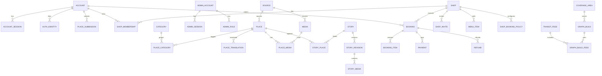

# ADR-0004 — Mô hình dữ liệu PostgreSQL/PostGIS

- **Trạng thái:** Proposed — chờ chủ dự án chốt
- **Ngày:** 18-11-2026
- **Người quyết định:** chủ dự án (chờ chốt)
- **Liên quan:** `ADR-0003-api-contract-auth-rbac.md`, `ADR-0002-account-roles.md`, `../02-architecture/01-system-context.md`, `../02-architecture/02-containers.md`, `../01-product/06-saved-and-contributed-places.md`, `../01-product/08-accounts-roles-partners.md`, `../01-product/09-stories-explore-search.md`

## Bối cảnh

GoWander lưu nhiều loại dữ liệu có tính chất rất khác nhau:

- **Nội dung địa lý:** place/POI, category, guide/story, media, nguồn và giấy phép.
- **Dữ liệu tham chiếu:** coverage area, transit feed, graph build, OSM/GTFS metadata.
- **Danh tính và quyền:** account client/partner, admin account, session, vai trò theo quán, lời mời, hồ sơ đối tác và giấy tờ.
- **Nghiệp vụ:** feedback, đề xuất địa điểm, moderation, thông báo (4 hộp thư), booking/cọc (R7), audit.
- **Dữ liệu local-first:** plan và saved places nằm trên máy; **không** lưu mặc định trên server ở R1.

Ràng buộc:

- PostgreSQL + PostGIS là database duy nhất (`02-containers.md`); không thêm document DB/NoSQL ở R1.
- Modular monolith: module sở hữu bảng của mình; không đọc/ghi chéo bảng tùy tiện (`02-conventions.md`).
- Mọi nội dung công khai phải truy được **nguồn, giấy phép, ngày lấy**; dữ liệu giả định gắn `ASSUMED`/`DEMO`.
- Song ngữ VI/EN; nội dung dài do Admin soạn theo khối, không nhận HTML tự do.
- Dữ liệu giấy tờ đối tác là dữ liệu cá nhân; vị trí người dùng là dữ liệu nhạy cảm; không lưu vị trí chính xác mặc định.
- Tiền (cọc, giá món) phải chính xác; không dùng số thực.
- Truy vấn địa lý (gần đây, bbox, kiểm trùng, coverage) cần index không gian.

Chưa có quyết định cho: dùng một schema hay schema theo module, `geometry` hay `geography`, UUID hay bigint, lưu story dạng JSONB hay bảng, lưu route hay không, retention PII. Nếu để mỗi module tự chọn, dữ liệu sẽ manh mún và khó kiểm quyền.

## Quyết định

### 1. PostgreSQL + PostGIS, SRID 4326

- Dùng **PostgreSQL + PostGIS** (phiên bản khoá ở bước dựng khung; ADR này không khoá version).
- Mọi cột không gian dùng **SRID 4326** (WGS84). Không trộn 3857 vào dữ liệu gốc; nếu cần hiển thị/phép chiếu thì đổi ở tầng đọc.
- **Điểm** (place, shop, ga, trạm) dùng `geography(Point, 4326)` để `ST_DWithin`/`ST_Distance` trả mét chính xác.
- **Vùng/đường** (coverage area, boundary) dùng `geometry(MultiPolygon/LineString, 4326)`; khi đo khoảng cách thì cast sang `geography`.
- Không lưu toạ độ dạng `text`/`jsonb`; không tự tính khoảng cách bằng công thức Haversine trong SQL khi PostGIS đã làm.
- Extension tối thiểu: `postgis`, `pg_trgm` (tìm gần đúng), `citext` (email không phân biệt hoa thường). Các extension nằm ở schema `public`; **không đặt bảng ứng dụng trong `public`**.

### 2. Schema theo module, một database

Một database, các schema theo bounded context:

| Schema | Module sở hữu | Bảng chính |
|---|---|---|
| `identity` | Identity | account, auth_identity, account_session, verification_code, password_history, admin_account, admin_session, admin_role, admin_recovery_code |
| `catalog` | Discover | source, category, category_translation, place, place_translation, place_category, story, story_revision, story_translation, story_media, story_place, place_submission, place_submission_photo, place_duplicate_candidate |
| `media` | Media | media, media_variant |
| `mobility` | Mobility | coverage_area, transit_feed, graph_build, graph_build_feed, route_cache (chỉ khi cần) |
| `partner` | Partner/Booking (phần quán) | shop, shop_membership, shop_invite, partner_application, application_document, document_access_log, menu_item, shop_booking_policy |
| `booking` | Booking | booking, booking_item, booking_status_event, payment, refund |
| `engagement` | Community/Feedback | feedback, notification, notification_delivery |
| `backoffice` | Admin/Backoffice | audit_log, import_run, import_issue |

Quy tắc:

- Mỗi bảng có **một module sở hữu**; module khác chỉ đọc qua view/API nội bộ, không ghi trực tiếp.
- Foreign key giữa schema được phép để bảo đảm toàn vẹn (ví dụ `booking.shop_id → partner.shop.id`), nhưng quyền ghi vẫn thuộc module sở hữu.
- Báo cáo/Admin có thể dùng **view chỉ đọc** (`backoffice.v_*`) thay vì join bảng nóng trong code.
- Không tạo schema cho module chưa làm (Community/AI/Ads/Affiliate) khi chưa có bảng thật; seam nằm ở module/feature flag.
- Tên bảng số nhiều hay số ít: chọn **số ít** (`place`, `booking`) cho nhất quán; tên cột `snake_case`.

### 3. Quy ước chung cho bảng

| Chủ đề | Quy ước |
|---|---|
| Khoá chính | `id uuid` do ứng dụng sinh **UUIDv7** (time-ordered, giảm phân mảnh index). Không dùng số tự tăng làm ID công khai |
| Thời gian | `created_at`, `updated_at` kiểu `timestamptz`, mặc định `now()`; API trả ISO 8601 UTC |
| Xoá mềm | `deleted_at timestamptz` cho nội dung/account; truy vấn công khai lọc `deleted_at is null`; unique index có điều kiện |
| Phiên bản nội dung | `version int` + `updated_by` cho bảng Admin sửa; optimistic locking khi cần |
| Trạng thái | Enum PostgreSQL hoặc `text` + `check`; giá trị tiếng Anh, ổn định |
| Tiền | `bigint` VND, `check (amount >= 0)`, `currency char(3) default 'VND'`; không `numeric` thập phân, không `float` |
| Chuỗi ngắn | `text` + `check (char_length(...) <= N)`; không `varchar(n)` tràn lan |
| JSON | `jsonb` chỉ cho payload linh hoạt (story block, policy snapshot, audit before/after); field quan trọng phải có cột riêng để query/index |
| PII | Không lưu số giấy tờ/token/ảnh trong bảng nội dung; giấy tờ ở storage, DB chỉ metadata + storage key |
| Audit | Append-only; không cấp `UPDATE/DELETE` cho role app |

### 4. Mô hình thực thể

#### 4.1 Nội dung địa lý (`catalog`)

**`catalog.source`** — nguồn dữ liệu và giấy phép:

| Cột | Kiểu | Ghi chú |
|---|---|---|
| `id` | uuid | |
| `code` | text unique | `osm`, `manual`, `partner`, `vietmap`… |
| `name`, `url` | text | Tên và URL nguồn |
| `license_code` | text | `ODbL-1.0`, `CC-BY-4.0`, `CC-BY-SA-4.0`, `CC0`, `proprietary`… |
| `license_url` | text | Link điều khoản |
| `attribution` | text | Chuỗi ghi công bắt buộc |
| `terms_reviewed_at`, `terms_reviewed_by` | timestamptz/text | Ai rà điều khoản, khi nào |
| `notes` | text | Giới hạn dùng/cache |

**`catalog.place`** — địa điểm:

| Cột | Kiểu | Ghi chú |
|---|---|---|
| `id` | uuid | |
| `slug` | text unique | Dùng cho URL/SEO sau này |
| `name` | text | Tên hiển thị mặc định (VI) |
| `location` | geography(Point,4326) | Bắt buộc khi publish |
| `entrance` | geography(Point,4326) | Có thể null; dùng chỉ dẫn điểm vào |
| `address`, `ward`, `district`, `city`, `country` | text | Địa chỉ hành chính; không thay thế geocoding |
| `bbox` | geometry(Polygon,4326) | Vùng thô để tìm kiếm/hiển thị, có thể null |
| `primary_category_id` | uuid | FK `category` — danh mục chính để hiển thị; quan hệ nhiều-nhiều ở `place_category` |
| `verification` | text | `unverified`, `verified`, `official` |
| `status` | text | `draft`, `published`, `hidden`, `merged` |
| `merged_into_id` | uuid | Khi gộp duplicate |
| `data_status` | text | `DEMO`, `OFFICIAL`, `ASSUMED`, `BEST_EFFORT` |
| `source_id`, `source_ref`, `source_url`, `retrieved_at` | | Truy vết nguồn |
| `opening_hours` | text | Cú pháp OSM; parse ở app, không coi là giờ chính thức nếu chưa xác minh |
| `phone`, `website`, `price_level`, `indoor`, `wheelchair` | | Thông tin hiển thị; `price_level` là ước tính |
| `search_text` | text | Chuẩn hoá chữ thường/bỏ dấu do app ghi; dùng cho trigram |
| `created_by`, `updated_by` | uuid | Admin account |
| `created_at`, `updated_at`, `deleted_at` | timestamptz | |

- `category` + `category_translation` + `place_category` cho phép một place nhiều category, có thứ tự.
- `place_translation` (place_id, locale, name, summary, description) cho EN; thiếu bản dịch thì fallback VI và **không** tự dịch máy ở R1.
- `place_media` (place_id, media_id, role `cover|gallery`, sort_order) — một ảnh bìa, nhiều ảnh gallery.
- Ràng buộc: `status='published'` ⇒ `location is not null`, `source_id is not null`, `data_status` không null; `verification='official'` chỉ khi có nguồn chính thức.
- `search_text` được cập nhật khi tạo/sửa place; có test cho tiếng Việt có dấu/không dấu.

**`catalog.story` / `story_revision`** — câu chuyện/guide:

- `story`: id, slug, kind (`historical|guide|food`), status (`draft|in_review|scheduled|published|hidden`), current_revision_id, published_at, created_by/updated_by.
- `story_revision`: id, story_id, version, `blocks jsonb`, `summary`, `cover_media_id`, `locale`, `created_at`, `created_by`. Bản published là **immutable**; sửa tạo revision mới.
- `blocks` theo schema allowlist (paragraph, header, list, quote, image, image-compare, timeline, place-card, audio, video, divider); server validate, không nhận HTML. Ảnh/video tham chiếu `media_id`, không nhúng binary.
- `story_media` (story_id, media_id, role, credit_override?) và `story_place` (story_id, place_id, sort_order) để app hiển thị “Đi tới đây”.
- `story_translation` nếu cần bản EN; nội dung dài có thể tách revision theo locale. R1: VI bắt buộc, EN nếu có; UI ghi rõ thiếu bản dịch.

**`media.media`** — ảnh/video:

| Cột | Ghi chú |
|---|---|
| `id` | uuid |
| `storage_key` | Khoá trong R2/S3/local; **không** lưu binary trong DB |
| `mime`, `bytes`, `width`, `height`, `sha256` | Kiểm tra trùng/hợp lệ |
| `credit`, `license_code`, `license_url`, `source_url`, `creator` | Bắt buộc với media công khai |
| `exif_stripped_at` | Bắt buộc với ảnh người dùng (R1.6) |
| `status` | `pending`, `approved`, `rejected`, `deleted` |
| `created_at`, `deleted_at` | |

- `media_variant` (media_id, label `thumb|card|full`, storage_key, width/height) — server tạo sẵn, không biến đổi theo request.
- Không xoá file còn dùng: kiểm qua FK ở các bảng nối (`place_media`, `story_media`, `menu_item.image_media_id`…); job định kỳ tìm orphan. Không cần bảng `media_usage` riêng ở R1.

**`catalog.place_submission`** (R1.5, ảnh R1.6):

- `id`, `account_id`, `status` (`pending|changes_requested|approved|rejected|merged|withdrawn`), `payload jsonb` (snapshot form), `name`, `category_id`, `location geography(Point,4326)`, `address`, `description`, `duplicate_of_id`, `reviewer_id`, `review_note`, `submitted_at`, `reviewed_at`, `published_place_id`.
- `place_duplicate_candidate` (submission_id, place_id, distance_m, name_score) — sinh khi nhận, chỉ để Admin xem, không tự gộp.
- `place_submission_photo` (submission_id, media_id, sort_order, status) — R1.6; 1–3 ảnh, pending, EXIF stripped.
- Không public submission khi pending; API chỉ trả cho chủ sở hữu/Admin.

#### 4.2 Danh tính và quyền (`identity`)

**`identity.account`** — client + partner:

| Cột | Ghi chú |
|---|---|
| `id` | uuid |
| `email` | `citext`, unique có điều kiện khi chưa xoá; có thể null nếu chỉ Google? R1.5 vẫn cần email |
| `phone` | text, unique có điều kiện; chưa xác minh SMS ở R1.5 |
| `password_hash` | Argon2id; null nếu chỉ dùng Google (vẫn khuyến khích đặt mật khẩu) |
| `email_verified_at`, `phone_verified_at` | |
| `display_name` | Tên hiển thị; có thể ẩn một phần |
| `locale` | `vi`, `en` |
| `status` | `active`, `locked`, `deleted` |
| `created_at`, `updated_at`, `deleted_at`, `anonymized_at` | |

- `identity.auth_identity` (account_id, provider `google|apple`, subject, email_at_provider, linked_at) unique (provider, subject).
- `identity.account_session` (id, account_id, realm `client|partner`, token_hash bytea unique, user_agent, ip_hash, created_at, last_seen_at, expires_at, revoked_at). Chỉ lưu hash token, không lưu token gốc.
- `identity.verification_code` (id, account_id, purpose `verify_email|reset_password`, code_hash, expires_at, attempts, consumed_at, created_at); dùng một lần; xoá/ẩn sau khi dùng. Mã 2FA Admin là TOTP, không dùng bảng này.
- `identity.password_history` (account_id, password_hash, created_at) — giữ 3 hash gần nhất để chặn tái sử dụng; không lưu plaintext.
- `identity.admin_account` (id, email, password_hash, display_name, status, totp_secret_encrypted, totp_confirmed_at, created_by, last_login_at, created_at, deleted_at). Admin tách hẳn account client.
- `identity.admin_session` (id, admin_account_id, token_hash, auth_level, step_up_at, user_agent, ip_hash, created_at, last_seen_at, expires_at, revoked_at).
- `identity.admin_role` (admin_account_id, role enum) — một admin có thể nhiều role; Owner cấp.
- `identity.admin_recovery_code` (admin_account_id, code_hash, used_at) — mã dự phòng dùng một lần.

**Quy tắc PII:**

- Email/phone cần cho đăng nhập nên lưu dạng đọc được (disk encryption + quyền DB); không log.
- `ip_hash` dùng HMAC-SHA-256 với khoá server, xoay khoá theo năm; không lưu IP thô trong session.
- Giấy tờ đối tác: file ở storage mã hoá; DB chỉ metadata; `application_document` không có cột nội dung file.
- Xoá tài khoản: đánh dấu `deleted_at`, anonymize `display_name`/`email`/`phone` sau thời gian grace (chính sách ở `05-security-privacy.md`); giữ audit tối thiểu.

#### 4.3 Đối tác, quán, thực đơn (`partner`)

**`partner.shop`**:

- `id`, `place_id` (FK `catalog.place`, unique), `name`, `kind` (`food|cafe|stay|tour|other`), `status` (`pending|active|suspended|closed`), `plan` (`basic|pro` — DEMO, chưa chốt giá), `features jsonb` (booking, preorder, deposit), `created_at`, `updated_at`.
- `place_id` bắt buộc khi shop active; trước đó có thể null trong hồ sơ.
- Không lưu toạ độ riêng nếu đã có place; nếu cần địa chỉ liên hệ thì dùng cột text.

**`partner.shop_membership`**:

- `shop_id`, `account_id`, `role` (`owner|manager|staff`), `status` (`invited|active|revoked`), `invited_by`, `joined_at`.
- Unique (shop_id, account_id) cho membership active; partial unique **một owner active** trên mỗi shop.
- `shop_invite`: id, shop_id, email/phone, role, token_hash, expires_at, accepted_at, created_by. Token một lần, hết hạn 48 giờ (đề xuất).

**`partner.partner_application`**:

- `id`, `kind`, `business_type` (`household|company`), `name`, `tax_id`, `address`, `location geography(Point,4326)`, `representative_name`, `phone`, `email`, `status` (`submitted|in_review|changes_requested|approved|rejected|closed`), `assigned_admin_id`, `decision_note`, `submitted_at`, `decided_at`.
- `application_document`: id, application_id, type (business_registration, id_card, food_safety, security_order, travel_licence, bank_confirmation, consent), storage_key, mime, bytes, sha256, status (`pending|accepted|rejected|expired`), expires_at, reviewed_by, reviewed_at.
- `document_access_log`: document_id, admin_id, action `view|download`, at, request_id. Không log nội dung file.
- Hồ sơ bị từ chối/đóng: xoá file sau 30 ngày (đề xuất, chờ chốt); DB giữ metadata + lý do.

**`partner.menu_item`**:

- `id`, `shop_id`, `kind` (`food|service`), `name`, `description`, `price_vnd bigint`, `currency 'VND'`, `image_media_id` (bắt buộc với `kind='food'`), `group`, `status` (`on_sale|sold_out`), `sort_order`, `created_at`, `updated_at`, `deleted_at`.
- Check constraint: `kind='food'` ⇒ `image_media_id is not null` (quy ước “món ăn luôn có ảnh”).
- Xoá mềm; booking item giữ snapshot tên/giá.

**`partner.shop_booking_policy`**:

- `shop_id` unique, `slot_minutes`, `capacity_per_slot`, `min_party`, `max_party`, `advance_min_days`, `advance_max_days`, `deposit_type` (`none|per_person|percent`), `deposit_value`, `cancel_policy jsonb`, `updated_at`.
- Chính sách được **snapshot** vào booking lúc đặt; sửa sau không đổi đơn cũ.

#### 4.4 Booking, cọc, thanh toán (`booking`, R7)

**`booking.booking`**:

| Cột | Ghi chú |
|---|---|
| `id` | uuid |
| `shop_id`, `account_id` | FK |
| `status` | `pending`, `confirmed`, `seated`, `completed`, `cancelled_by_customer`, `cancelled_by_shop`, `no_show` |
| `party_size` | int > 0 |
| `slot` | `tstzrange` — thời gian giữ bàn |
| `policy_snapshot` | jsonb — chính sách lúc đặt, immutable |
| `subtotal_vnd`, `deposit_vnd`, `currency` | bigint VND; `deposit_vnd` có thể 0 |
| `idempotency_key` | text; unique (account_id, key) |
| `note` | text ngắn |
| `created_at`, `updated_at`, `cancelled_at` | |

- Exclusion constraint: `EXCLUDE USING gist (shop_id WITH =, slot WITH &&) WHERE (status IN ('pending','confirmed','seated'))` để chặn trùng ô bàn; kiểm ở DB, không chỉ app.
- `booking_item` (booking_id, menu_item_id nullable, name_snapshot, unit_price_vnd, quantity) — giữ tên/giá lúc đặt.
- `booking_status_event` (booking_id, from_status, to_status, actor_type, actor_id, reason, created_at) — lịch sử trạng thái.
- `payment` (booking_id, provider, provider_ref, amount_vnd, status `pending|authorized|captured|failed|refunded`, idempotency_key, created_at, captured_at); `refund` (payment_id, amount_vnd, status, reason, created_at, completed_at).
- Không lưu số thẻ/CVV; cổng thanh toán giữ. Nếu chưa chốt thu cọc qua GoWander, bảng payment để seam, không bật endpoint.

#### 4.5 Feedback, thông báo (`engagement`)

**`engagement.feedback`**:

- id, account_id nullable, category, message, contact_email/phone nullable (chỉ khi guest muốn phản hồi), status (`new|in_review|resolved|closed`), admin_note, app_version, locale, request_id, created_at, resolved_at.
- Không log/không public contact; retention đề xuất 12 tháng.

**`engagement.notification`** — 4 hộp thư:

- `audience` (`client|shop|partner|admin`), `recipient_id` (account_id/shop_id/admin_account_id), `shop_id` nullable, `kind`, `title`, `body`, `payload jsonb`, `read_at`, `dedupe_key`, `created_at`, `expires_at`.
- `notification_delivery` (notification_id, channel `in_app|email|sms|push`, status, attempts, last_error, sent_at) — email/SMS qua outbox; không lưu nội dung nhạy cảm trong payload.
- AdminInbox là `audience='admin'` + kind task; AdminNotifications là nơi gửi (không phải bảng riêng).
- ShopNotifications/PartnerNotifications dùng cùng bảng, lọc theo audience/recipient; không tạo 4 bảng trùng schema.

#### 4.6 Audit, import (`backoffice`)

**`backoffice.audit_log`**:

- id, actor_type (`account|admin|system`), actor_id, action, entity_type, entity_id, before jsonb, after jsonb, request_id, ip_hash, created_at.
- Append-only; role app chỉ `INSERT` (qua service) và `SELECT` cho Admin được phép; không `UPDATE/DELETE`.
- `before/after` đã che PII/bí mật; không lưu token/mật khẩu/giấy tờ.

**`backoffice.import_run`**:

- id, source_id, kind (`osm|gtfs|manual|media`), status (`running|success|failed|partial`), started_at, finished_at, counts jsonb, checksum, error_summary, operator_id.
- `import_issue` (run_id, severity, code, message, entity_ref) — lỗi từng dòng/feature; không chứa PII.
- Dữ liệu thô (PBF, GTFS zip) **không** vào DB/git; chỉ metadata + checksum. Script import tái lập được.

#### 4.7 Routing metadata (`mobility`)

- `coverage_area`: id, name, `area geometry(MultiPolygon,4326)`, `modes text[]`, `data_status`, `active_from`, `active_to`, `notes`. Một điểm được hỗ trợ nếu `ST_Intersects(area, point)` và mode nằm trong `modes`.
- `transit_feed`: id, feed_id (`metro_l1`, `bus_osm`), name, source_id, `data_status`, `valid_from`, `valid_to`, `checksum`, `built_at`, `notes`; feed giả định ghi rõ phần có nguồn/ước tính.
- `graph_build`: id, version (hash ngắn), `otp_version`, `osm_date`, `coverage_area_id`, `built_at`, `checksum`, `config_hash`, `status`.
- `graph_build_feed` (graph_build_id, transit_feed_id) — một graph có nhiều feed.
- `route_cache` chỉ thêm khi đo thấy cần; nếu có, khoá là hash của request đã chuẩn hoá, TTL ngắn, **không lưu toạ độ thô**; không log. R1 mặc định không cache route.
- Không lưu route/legs của người dùng; route sinh từ OTP, trả về client, không thành lịch sử di chuyển.

### 5. Truy vấn địa lý và index

| Nhu cầu | Cách làm | Index |
|---|---|---|
| Gần đây | `ST_DWithin(location, :point::geography, :meters)` + `ORDER BY ST_Distance(...)` | GiST `place_location_gix` |
| Bbox bản đồ | `location && ST_MakeEnvelope(...)::geography` (hoặc `ST_Intersects`) | GiST |
| Kiểm coverage | `ST_Intersects(coverage_area.area, :point)` | GiST `coverage_area_gix` |
| Kiểm trùng đề xuất | `ST_DWithin` 50 m + trigram tên; trả candidate, không auto-merge | GiST + GIN trigram |
| Tìm theo tên | `search_text % :q` / `similarity`; ưu tiên prefix; limit | GIN `pg_trgm` |
| Lọc category/status | B-tree composite `(status, primary_category_id)`; join `place_category` cho lọc nhiều category; partial index `where status='published'` | B-tree |
| Lịch sử đơn | `(shop_id, created_at desc)`; `(account_id, created_at desc)` | B-tree |
| Chống trùng slot | Exclusion constraint `shop_id + tstzrange` | GiST |

- Khoảng cách/tìm kiếm mặc định **bán kính 2 km** cho nearby, tối đa 10 km; *(ASSUMED, cấu hình)*.
- `search_text` chuẩn hoá: lowercase, bỏ dấu tiếng Việt, gộp khoảng trắng; app ghi khi tạo/sửa; test với “Nguyễn Huệ”/“nguyen hue”.
- Không dùng `ST_Distance` trên `geometry` 4326 để lấy mét; luôn dùng `geography` hoặc cast.
- `LIMIT` bắt buộc cho mọi truy vấn public; không trả toàn bộ bảng.

### 6. Nguồn, giấy phép, nhãn tin cậy

- Mọi place/media/story công khai phải có `source_id` (hoặc `source_url` + `license_code` với nội dung biên tập) và `attribution` hiển thị được.
- `data_status`:
  - `DEMO`: seed/dữ liệu mẫu, không dùng như fact.
  - `OFFICIAL`: có nguồn chính thức, có bằng chứng.
  - `ASSUMED`: lịch/giá/trọng số giả định cho pilot.
  - `BEST_EFFORT`: hình học OSM không có timetable; chưa dùng R1.
- Không lưu `UNSUPPORTED` trên place; đó là trạng thái coverage/route trả từ API.
- OSM: ghi “© OpenStreetMap contributors”, ODbL; giữ `osm_type`/`osm_id` trong `source_ref`; không trộn dữ liệu ODbL vào database đóng nếu chưa rà nghĩa vụ share-alike.
- GTFS giả định: `transit_feed.data_status='ASSUMED'`, `notes` ghi phần có nguồn/ước tính; không gọi là lịch chính thức.
- Media: `credit`, `license_code`, `source_url` bắt buộc; thiếu thì không publish. Ảnh người dùng R1.6 phải `exif_stripped_at` và qua duyệt.
- Giá vé/giá món: nếu không có nguồn, lưu `ASSUMED` và UI ghi “ước tính”; không trộn với giá chính thức.

### 7. Migration, seed, quyền DB

- Migration có số thứ tự, **up/down**, chạy trong transaction khi có thể; không sửa migration đã áp dụng; thay đổi lớn tách bước (add column → backfill → constraint).
- Một migration thuộc một module; không trộn schema khác trừ khi tạo FK/view cần thiết.
- Seed tách khỏi migration; seed `DEMO` idempotent; dữ liệu thật nạp bằng script có `import_run`.
- Role DB:
  - `gowander_owner`: chạy migration/seed, sở hữu schema; không superuser.
  - `gowander_app`: runtime API, chỉ quyền cần thiết; `SELECT` bảng public, `INSERT/UPDATE` bảng nghiệp vụ, không `DELETE` audit.
  - Không dùng `ALTER DEFAULT PRIVILEGES`; mỗi migration `GRANT` tường minh cho bảng mới.
- `search_path` tường minh; không để `public` đứng trước schema ứng dụng.
- Backup: dump logic + WAL; restore test trước pilot; không backup file media vào DB.

### 8. Lưu trữ, retention và riêng tư

| Dữ liệu | Lưu ở đâu | Retention đề xuất | Ghi chú |
|---|---|---|---|
| Plan/saved places | Thiết bị | Người dùng xoá | Không lên server R1 |
| Vị trí route request | Không lưu | — | Không log toạ độ; `requestId` để trace |
| Account client | DB | Đến khi xoá + grace | Anonymize sau xoá |
| Session | DB | Hết hạn/thu hồi | Token hash; `ip_hash` 30 ngày |
| Feedback | DB | 12 tháng | Contact chỉ khi cần phản hồi |
| Giấy tờ đối tác | Storage + metadata | 30 ngày sau từ chối/đóng | Mã hoá; access log |
| Audit | DB | 24 tháng | Append-only; che PII |
| Ảnh | Storage | Theo vòng đời nội dung | Credit/license; xoá khi không dùng |
| Route cache | Không có R1 | — | Nếu thêm: TTL ngắn, hash, không toạ độ thô |

> Các con số retention là **đề xuất**, phải được chốt trong `05-security-privacy.md` và rà pháp lý (Luật 91/2025, NĐ 356/2025) trước khi mở tính năng tương ứng. Chưa có luật sư xác nhận.

## Lý do

1. **Schema theo module** làm ranh giới modular monolith rõ, dễ cấp quyền DB và tránh “với tay” sang bảng module khác. Một schema chung dễ bắt đầu nhưng khó kiểm soát khi thêm Identity/Booking.
2. **`geography` cho điểm** trả khoảng cách mét đúng, không cần tự chiếu; `geometry` cho vùng/đường phù hợp tính toán hình học.
3. **UUIDv7** giảm phân mảnh index so với UUIDv4, không lộ số thứ tự như bigint; sinh ở app để không phụ thuộc version PostgreSQL.
4. **JSONB có kiểm soát** cho story block/policy snapshot phù hợp dữ liệu lồng nhau; field query chính vẫn là cột riêng.
5. **Nguồn/giấy phép là cột bắt buộc**, không phải metadata tùy chọn; đây là yêu cầu pháp lý và là cách tránh “ảnh không rõ nguồn”.
6. **Không lưu route/vị trí** giữ privacy by default; route cache chỉ thêm khi có nhu cầu và có biện pháp che dữ liệu.
7. **Tiền là bigint VND** tránh sai số; policy snapshot bảo vệ đơn cũ khi quán đổi chính sách.
8. **Audit append-only** là yêu cầu cho thao tác Admin/Partner và dữ liệu tiền.

## Phương án đã cân nhắc

| Phương án | Vì sao không chọn |
|---|---|
| **Một schema `public` cho tất cả** | Đơn giản lúc đầu nhưng khó cấp quyền theo module, dễ join chéo; khi thêm Identity/Booking sẽ khó tách |
| **Schema per microservice/DB riêng** | Quá phức tạp cho monolith/đội nhỏ; transaction phân tán, vận hành nặng |
| **Chỉ dùng `geometry` 4326** | Đo khoảng cách phải cast/chiếu; dễ sai đơn vị; `geography` phù hợp điểm |
| **Chỉ dùng `geography` cho cả polygon/line** | Một số phép hình học/không gian hạn chế hơn; `geometry` linh hoạt hơn cho vùng |
| **bigint tự tăng làm ID công khai** | Lộ số lượng, khó merge/import, không hợp UUID; UUIDv7 đủ tốt |
| **Lưu story dưới dạng HTML** | App Compose không render HTML tốt; XSS; khó kiểm block/credit; chọn JSON block |
| **Mỗi loại thông báo một bảng** | Trùng schema, khó query; một bảng + audience/recipient đủ |
| **Lưu ảnh/binary trong PostgreSQL** | Phình backup, không CDN; lưu storage key |
| **Lưu route/legs để cache lâu** | Dữ liệu vị trí; TTL/privacy phức tạp; R1 không cần |
| **MongoDB/NoSQL cho place** | Mất PostGIS/transaction; dữ liệu quan hệ và geo query là chính |
| **Lưu plan/saved trên server R1** | Trái guest-first/local-first; cần account và đồng bộ |

## Hệ quả

### Tích cực

- Ranh giới module rõ, dễ review migration và cấp quyền DB.
- Truy vấn địa lý nhanh, đúng đơn vị; kiểm trùng/coverage có index.
- Nguồn/giấy phép là một phần schema, không phải việc dọn sau.
- Booking/cọc có ràng buộc DB chống trùng slot, snapshot chính sách.
- Audit/append-only và retention có chỗ để triển khai.

### Tiêu cực / chi phí

- Nhiều schema/bảng hơn; migration và quyền phức tạp hơn một schema.
- PostGIS + trigram cần cấu hình, backup/restore nặng hơn.
- UUIDv7 sinh ở app đòi hỏi thư viện/thống nhất; seed/import phải sinh ID.
- JSONB block/policy cần validate schema và test kỹ; dễ lưu dữ liệu sai nếu chỉ tin client.
- Retention/PII cần chính sách và job xoá/anonymize; chưa có luật sư.
- Exclusion constraint booking cần hiểu Postgres; có thể chặn nhầm nếu slot không chuẩn hoá.

### Rủi ro

- PostGIS/`geography` trên dữ liệu lớn có thể chậm nếu thiếu index/ANALYZE; cần đo trước pilot.
- ODbL share-alike có thể ảnh hưởng cách phân phối dữ liệu OSM; cần luật sư rà trước khi công bố bản sao.
- Lưu email/phone/giấy tờ là PII; sơ hở quyền DB/log là rủi ro cao.
- Schema-per-module có thể bị phá vỡ bởi query Admin tiện tay; cần review và view.
- UUIDv7 + nhiều bảng làm seed/import phức tạp; cần script chuẩn.
- Các con số retention/50 m/2 km là giả định, cần chỉnh theo dữ liệu thật.

## Việc tiếp theo

- [ ] Chủ dự án duyệt mô hình schema/ID/tiền/retention; chốt các số đề xuất.
- [ ] Viết `../02-architecture/03-data-model.md` chi tiết bảng/cột/index/ERD cho R1.
- [ ] Viết migration đầu tiên khi dựng khung: extension, schema, bảng R1 (place/category/media/story/feedback/account? theo phase).
- [ ] Viết test PostGIS: nearby, bbox, duplicate, coverage; test quyền DB role app.
- [ ] Chốt công cụ migration/version PostgreSQL ở `../04-development/01-toolchain.md` (bước scaffold).
- [ ] Rà ODbL/CC BY-SA và retention với luật sư trước khi publish dữ liệu/ảnh.
- [ ] Thiết kế job xoá/anonymize account, document, feedback; ghi bằng chứng chạy thử.
- [ ] Khi làm R1.5: bổ sung submission/photo; R6: shop/membership; R7: booking/payment.

## Tham khảo

- `../02-architecture/02-containers.md` — PostgreSQL/PostGIS là container dữ liệu duy nhất.
- `../01-product/06-saved-and-contributed-places.md` — saved places local-first, submission/moderation.
- `../01-product/08-accounts-roles-partners.md` — account, shop_membership, hồ sơ đối tác, booking/cọc.
- `../01-product/09-stories-explore-search.md` — story block, media credit, place-card.
- Repo cũ `../GoWander`: `ADR-028` (PostGIS, schema, quyền DB), `ADR-035` (R2/media), `ADR-036` (local storage), `ADR-041` (Editor.js block JSON). Chỉ tham khảo; v2 có schema/retention riêng.
